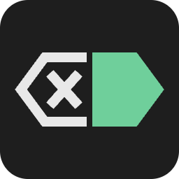
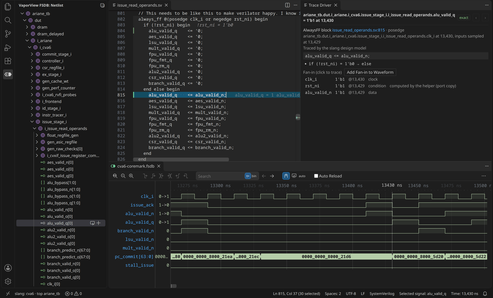
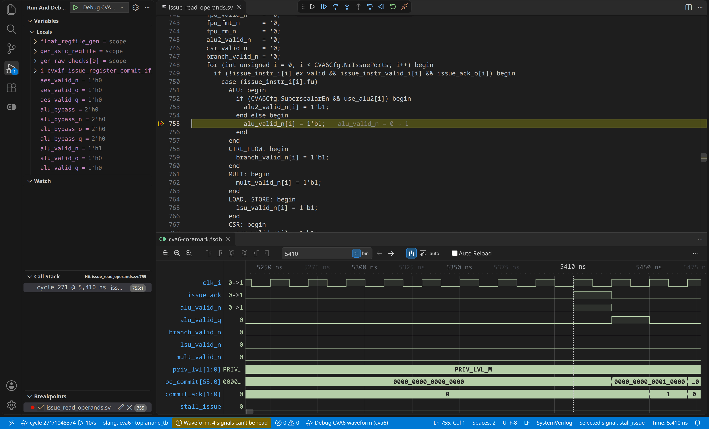
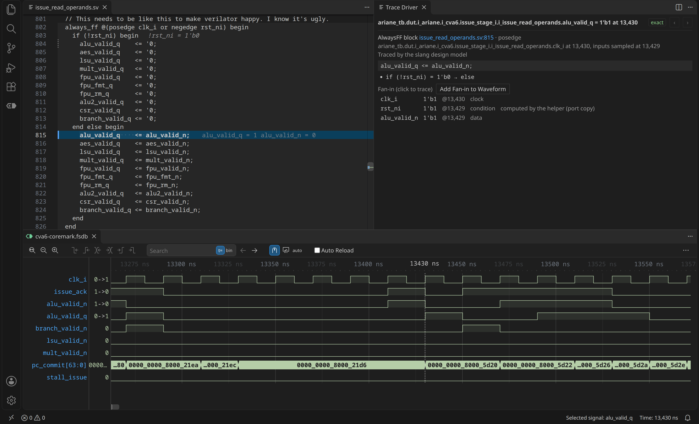
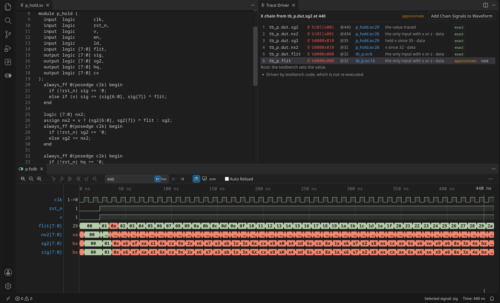
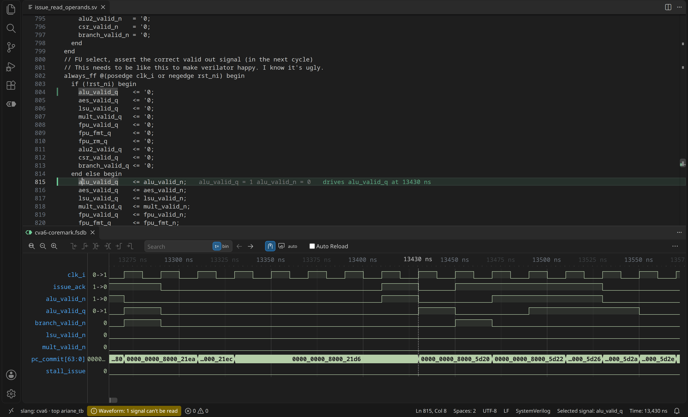

<p align="center"></p>

# VaporView FSDB

[Install](#quickstart) · [Features](#features) · [Set up tracing](#set-up-tracing) · [Viewer guide](VIEWER.md)

VaporView FSDB is a fork of [VaporView](https://github.com/Lramseyer/vaporview) (GPL-3.0) that opens FSDB waveform
dumps in VS Code; it is not affiliated with or endorsed by upstream VaporView. Its bundled reader, wisp-helper,
decodes FSDB and WCZ itself, so no vendor software is needed, and VCD, FST and GHW open too.

0.1.0 is a pre-release, installed from `.vsix` files on the GitHub release.

## Why

- **Your dump, next to your code:** open FSDB in VS Code beside the source, locally or over Remote-SSH on the
  machine that ran it.
- **From an x to its cause:** select a signal to see the line driving it, then follow the chain back to where the x
  started.
- **Jump to when it goes wrong:** stop at the first time a value or condition holds (for example `cnt == 8'hff`),
  then step cycle by cycle with the source beside the waveform.

## Quickstart

Download the VSIX for your platform from the release, install it, and open a dump:

```bash
code --install-extension vaporview-fsdb-0.1.0-linux-x64.vsix   # Linux, or the Remote-SSH host
code --install-extension vaporview-fsdb-0.1.0-universal.vsix   # macOS and Windows
code path/to/run.fsdb
```

With Remote-SSH, install from the remote window's terminal so the extension runs on the Linux host. Uninstall an
earlier development build first (`unpublished-tbd.vaporview-wisp` or `unpublished-tbd.wisp`).

The extension keeps upstream VaporView's `vaporview.*` ids, so only one of the two can be enabled at a time.



## Features

### FSDB and WCZ

A `.fsdb` or `.wcz` file opens in the waveform editor, decoded by the bundled reader; no vendor software is bundled,
linked or loaded. Large signals load in windows for the visible range, so a dump with millions of changes per signal
opens without loading whole. The editor link also needs slang-server, and tracing needs your design.

### Debug mode

Break on a value, a condition or a source line: run **Debug This Waveform** (F5) and the dump runs to the first
cycle where it holds (also on a signal change or text). Step a cycle at a time, forward or back, with watches,
Evaluate and Locals. The editor highlights the stopped line and shows its values at the marker as quiet text after
it (a → b where they changed); set `vaporview.debug.inlineValues` to `all` for every line, or `off`.



### Trace Driver

Select a signal and run **Trace Driver at Marker**, from the waveform row or for the signal under the editor cursor.
It shows the statement that drove the value at the marker, the branch taken, and its inputs with their values;
step through the trace, open the statement, or add its inputs to the waveform.



### Trace to Root

Run **Trace to Root** (Trace-X) to follow the drivers back, step by step, to where a value came from, for example an
x. Each step is labelled exact or approximate, and candidate causes are ranked.



### Editor link

The SystemVerilog editor and the waveform are linked: add a signal from the source, show a signal in the source, and
see the values at the marker as quiet text after the current line (`vaporview.sourceLink.inlineValues`: `all` for
every line, `off`). Select a signal, or put the cursor on its name, and the lines that assign it are marked; the one
driving the value at the marker is highlighted with a note. Rows of enum-typed signals show member names.



### No value

A signal at a time has a real value from the dump (including the simulator's x and z), a value resolved through the
design and labelled "via …", or **no value** with the reason, such as "not in the dump". "No value" is never drawn or
evaluated as x, anywhere in the extension.

Everything from VaporView also works (VCD, FST, GHW, markers, value formats, search, sessions); see the
[viewer guide](VIEWER.md).

## Keys

| Key | Where | Does |
|---|---|---|
| F5 | waveform viewer | Debug This Waveform |
| F10 / Ctrl+F10 (Cmd+F10 on macOS) | debugging a waveform | step one cycle forward / back |
| Ctrl+T | waveform viewer | Trace Driver at Marker |
| Ctrl+Alt+T | waveform viewer | Trace to Root |
| Ctrl+Alt+T / Ctrl+Alt+Shift+T | SystemVerilog editor | Trace Driver / Trace to Root at the cursor |
| Ctrl+Alt+W | SystemVerilog editor | add the signal at the cursor to the waveform |
| Alt+Shift+D | waveform viewer | show the selected signal in the source |

## Set up tracing

Trace Driver, Trace to Root and source-line breakpoints need the design the dump was simulated from. The design
model (built on slang) ships prebuilt, so nothing is compiled on your machine. Give it the design in one of two ways:

- **A slang profile:** pick a `.f` build file or a top level for the editor link; tracing uses the same design.
- **`vaporview.trace.designArgs`:** slang arguments such as `["-f", "files.f", "--top", "tb"]`, relative to
  `vaporview.trace.designRoot` (default: the workspace folder whose settings set it). A `build` entry in
  `.slang/server.json` works too.

## Editor link setup

The editor link talks to slang-server, which is not bundled. Install it in one of two ways:

- **The slang extension** (`Hudson-River-Trading.vscode-slang`, 0.3.3 tested): accept its offer to install
  slang-server. The link then shares that extension's server, and you also get highlighting, completion and hover.
- **slang-server alone:** put it on your PATH or set `vaporview.sourceLink.slangServerPath`. The link starts its own
  server, used only for the link; the editor has no SystemVerilog language features.

Then run **Waveform Link: Set SystemVerilog Top Level**, or accept the offer to elaborate with the waveform's top
module. Profiles and several designs per window are covered in [EDITOR-LINK.md](EDITOR-LINK.md).

## Platforms

| Where the extension runs | FSDB / WCZ | Tracing | VSIX |
|---|---|---|---|
| Linux x64 | yes (glibc 2.17 or newer) | yes | `linux-x64` |
| Remote-SSH to a Linux x64 host | yes, on the host | yes | `linux-x64`, on the host |
| macOS, Apple silicon and Intel | yes (macOS 13.3 or newer) | yes (macOS 11 or newer) | `universal` |
| Windows | through Remote-SSH or WSL | not yet | `universal` |

VCD, FST and GHW open everywhere. The extension runs where your files are, so with Remote-SSH it runs on the Linux
host. wisp-helper and the design model are prebuilt for Linux x64 and macOS. There is no linux-arm64 VSIX in 0.1.0.

## Known gaps

- Windows: no local FSDB or WCZ and no driver tracing yet; use Remote-SSH or WSL.
- Only one of VaporView FSDB and upstream VaporView can be enabled at a time.
- slang-server is not bundled; see [Editor link setup](#editor-link-setup).
- No linux-arm64 VSIX in 0.1.0.
- Planned, not in 0.1.0: a schematic view and an FSM (state diagram) view.
- Distributed as `.vsix` files only; Marketplace and Open VSX publishing comes later.

## Optional cross-check

The Trace panel shows a Cross-Check button only when it finds your own Verdi installation. Nothing from it ships
with VaporView FSDB. Set `vaporview.trace.verdiHome` if it is not on your PATH.

## Building

**The extension.** You need Node 22, Rust with the `wasm32-unknown-unknown` target and `cargo install wasm-tools`
(see GETTING_STARTED.md for the details inherited from VaporView):

```sh
npm ci
npm run compile-wasm      # wellen's VCD / FST / GHW reader -> filehandler.wasm
npm run check-types
node esbuild.js           # dist/; then Run and Debug in VS Code, or package as below
```

**wisp-helper** (the FSDB / WCZ reader, MIT, in `wisp-helper/`): C++17 with a compiler that has floating-point
`std::to_chars` (GCC 11+ or a recent clang) and zlib.

```sh
cd wisp-helper && make    # -> build/helper/wisp-helper; `make check` runs its checks
```

Point `vaporview.wispHelperPath` at the built binary to use it in a development build.

**Release VSIXes.** `tools/package.sh --targets "linux-x64 universal"` builds the bundles, wisp-helper for Linux
x86-64 (with [zig](https://ziglang.org) as the cross toolchain, glibc 2.17 floor) and for macOS (on a Mac), the
prebuilt design model, the third-party notices and the VSIX files in `dist-vsix/`, then checks them with
`tools/check-vsix.sh`. Building the Linux design model from a Mac needs `SVM_HOST`, the ssh alias of a Linux x86-64
host.

## Copying

GPL-3.0 (LICENSE). NOTICE gives the origin of the code (VaporView, the cmux waveform modules, wellen, wisp-helper,
slang), and THIRD-PARTY-NOTICES.txt in each VSIX carries the full licence text of every bundled component.

Verdi is a trademark of Synopsys, Inc. VaporView FSDB is not affiliated with or endorsed by Synopsys.

## Credits

VaporView, and so VaporView FSDB, uses the [wellen](https://github.com/ekiwi/wellen) library compiled to WASM for
file parsing and data management. VaporView thanks the Surfer team for their support, and it is compatible with the
Surfer server protocol.

Most screenshots show the open-source CVA6 core (OpenHW Group).

VaporView contributors:
[@lramseyer](https://github.com/Lramseyer) (owner),
[@heyfey](https://github.com/heyfey),
[@marco-fr](https://github.com/marco-fr),
[@DGGua](https://github.com/DGGua),
[@AndrewNolte](https://github.com/AndrewNolte),
[@shlyahtink](https://github.com/shlyahtink),
[@haroune-dev](https://github.com/haroune-dev),
[@amikhalev](https://github.com/amikhalev).
